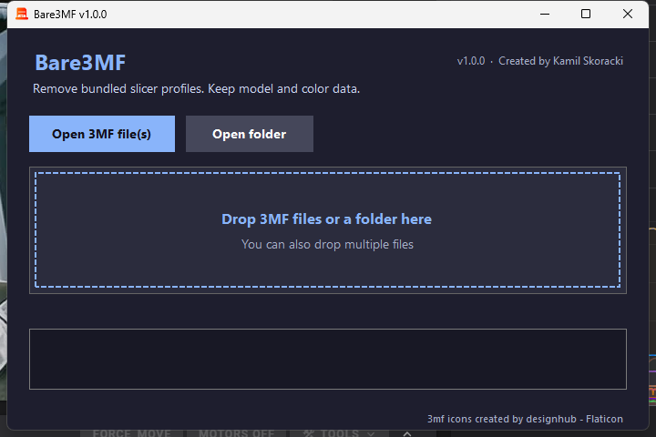

# Bare3MF

> **Are you tired of 3MF files destroying your slicer configuration?**
>
> Say no more. Bare3MF removes everything that isn't needed and keeps your color configuration.

Bare3MF is a Windows desktop app that cleans bundled slicer profiles out of `.3mf` files. Share or archive a 3MF without carrying someone else's printer, filament, or print settings — while keeping the model, plate layout, and multi-color extruder assignments.



## Why Bare3MF?

Opening a shared 3MF can silently replace your carefully tuned slicer profiles. Bare3MF strips those bundled profiles so the file is safe to open, while preserving the model and its color separation.

- Removes bundled slicer, printer, and filament profile configs.
- Keeps model geometry and plate layout.
- Keeps per-object and per-part extruder assignments used by multi-color models.
- Works with single files, multiple files, and whole folders.
- Can overwrite files in place or save cleaned copies to another folder.
- Runs entirely locally — your files never leave your PC.

## What is removed

Bare3MF removes profile and config files inside the 3MF archive's `Metadata/` folder, including:

- `Metadata/project_settings.config` — printer, filament, and print profiles.
- Other `Metadata/*.config` profile files.

## What is kept

- `3D/3dmodel.model` — model geometry.
- `Metadata/model_settings.config` — objects, parts, plate layout, and extruder/color assignments.
- `Metadata/_model.config` — model metadata.
- `_rels/.rels`, `[Content_Types].xml`, thumbnails, and all other non-profile files.

> **Color note:** Bare3MF preserves the multi-color mapping (which part uses extruder 1, 2, etc.). The exact filament hex palette may be stored in the removed `project_settings.config`; if needed, reselect filament colors in your slicer without losing the color separation.

## Usage

1. Download or build `Bare3MF.exe`.
2. Launch the app.
3. Drag and drop one or more `.3mf` files, or a folder, onto the drop area.
   - You can also use **Open 3MF file(s)** or **Open folder**.
4. Choose:
   - **Overwrite existing** — replace the original file.
   - **Save to folder…** — write a cleaned copy elsewhere.
5. Optionally enable **Apply this choice to all remaining files**.
6. Follow the progress and results in the log.

Overwrite mode writes to a temporary file first and only replaces the original after the cleaned archive is complete.

## Requirements

- Windows 10 or Windows 11 (x64).
- No .NET runtime installation is required when using the published self-contained executable.

## Build from source

Requirements: .NET 10 SDK.

```powershell
dotnet build
```

Publish a self-contained single-file executable:

```powershell
dotnet publish -c Release -r win-x64 --self-contained true -p:PublishSingleFile=true -p:IncludeNativeLibrariesForSelfExtract=true
```

Output:

```text
bin\Release\net10.0-windows\win-x64\publish\Bare3MF.exe
```

## Project structure

```text
Bare3MF/
├── Assets/
│   ├── ico.ico
│   └── screenshot.png
├── Bare3MF.csproj
├── ConfigSanitizer.cs
├── MainForm.cs
├── Program.cs
└── README.md
```

## How it works

Bare3MF opens the `.3mf` file as a ZIP archive, identifies bundled slicer profile configs under `Metadata/`, and rebuilds the archive without them. Everything else is copied unchanged. The sanitizer preserves `Metadata/_model.config` and `Metadata/model_settings.config` so multi-color extruder mappings survive the cleanup.

## Credits

- Created by **Kamil Skoracki**
- Version **1.0.0**
- Icon: [3mf icons created by designhub - Flaticon](https://www.flaticon.com/free-icons/3mf)
